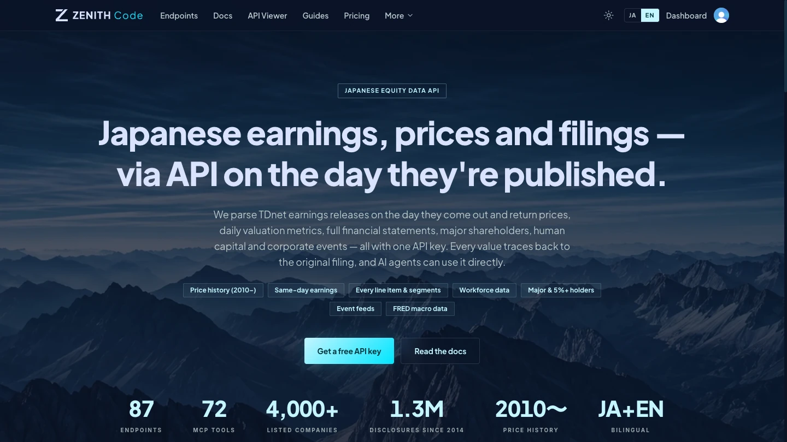
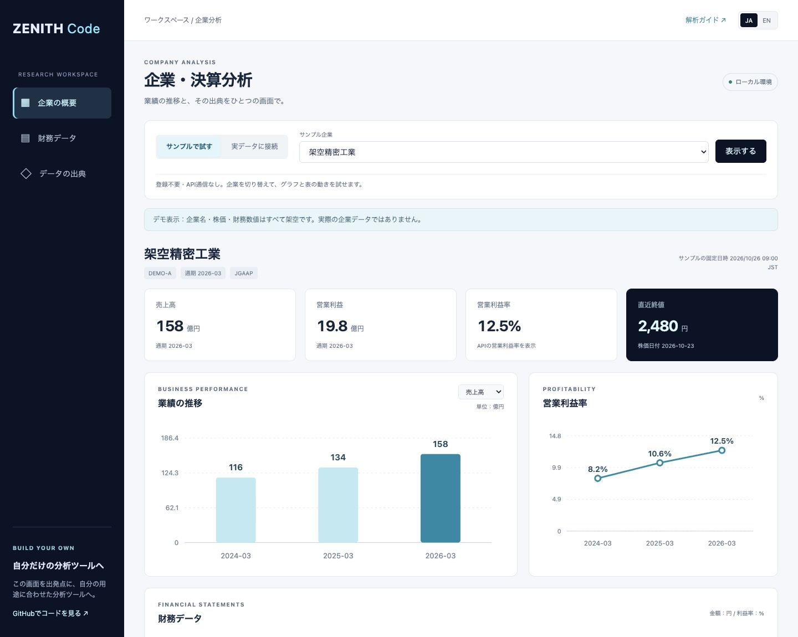
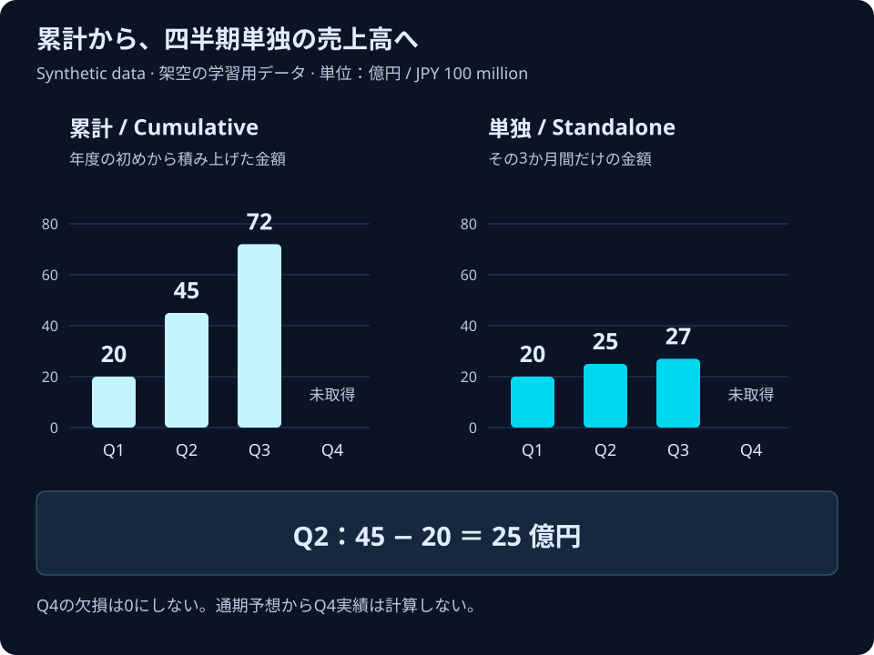

# ZENITH Code サンプルコード

[](https://zenithcode.net)

サービス画面は2026年10月26日時点。画像をクリックすると公式サイトが開きます。

**日本株の株価と企業財務を、1つのAPIで。**

[English](README.md) · [公式サイト](https://zenithcode.net) · [ドキュメント](https://zenithcode.net/docs) · [APIキーを取得](https://zenithcode.net/sign-up) · [法人のご相談](https://zenithcode.net/contact-sales)

ZENITH Codeを運営する株式会社Crabgrassの公式Python・JavaScriptサンプルです。

ZENITH Codeは、取引所との正式な契約に基づく日本株の株価に加え、標準化した財務数値と、決算書の階層を残した全科目のデータを提供します。同じ証券コード・APIキーで株価と財務を取得し、ご自身の分析に利用できます。株価は**終値ベースの日次データで、リアルタイムではありません**。

## まず何を試しますか？

| やりたいこと | 入口 | 登録 |
| --- | --- | --- |
| 分析コマンドを架空のデータで試す | `python3 python/zenith_examples.py compare --symbols DEMOA,DEMOB --demo` | 不要・通信なし |
| 数値の読み方とグラフを試す | [TDnet③・④の学習サンプル](docs/learning.ja.md) | 不要・追加パッケージ不要 |
| 実際の株価・財務を取得する | **[会員登録してAPIキーを取得 →](https://zenithcode.net/sign-up)** | 必要 |
| エージェントに設定を手伝ってもらう | [コピーして使える依頼文と手順](docs/agent-start.md) | 学習は不要、実データは必要 |

### 動く企業・決算分析テンプレート



銘柄の選択、売上・利益のグラフ、財務の表、出典確認をひとつの画面で試せます。登録不要のデモから始め、会員登録後は手元の非公開環境で実データへ接続できます。日英切り替え・スマホ表示と、**クール・ポップ・ダーク**のスタイル選択に対応しています。各カード・グラフ・表の「使っているAPI」から、エンドポイント・取得項目・表示への変換方法を確認できます。

**[起動手順とカスタマイズ方法 →](templates/company-analysis/README.ja.md)**

### 登録前に、こんなグラフを作れます



**架空データによる学習用の完成例です。** [コードと解説](docs/learning.ja.md)から、期間・単位を読む練習とグラフ作成ができます。実データのAPIサンプルは下の手順で利用します。

### サービス内の解説記事

TDnetを先に学び、その後EDINETへ進みます。

1. [TDnet解析ガイド](https://zenithcode.net/learn/tdnet-xbrl)：決算短信とXBRL、期間・単位の読み方。
2. [EDINET解析ガイド](https://zenithcode.net/learn/edinet-xbrl)：法定開示とタクソノミ・階層構造。
3. [財務データAPIの選び方](https://zenithcode.net/learn/financial-data-api-selection)：解析を自作する範囲とAPI活用の考え方。

## 最初の実行：実データ

1. [会員登録](https://zenithcode.net/sign-up)し、適用されるデータ利用条件を確認・同意したうえで、ダッシュボードからAPIキーを作ります。Freeプランがあります。[最新の料金・利用範囲](https://zenithcode.net/pricing)をご確認ください。
2. このリポジトリを取得します。

```sh
git clone https://github.com/Crab-grass/zenith-code-examples.git
cd zenith-code-examples
```

3. **Python 3.9以上**で実行します。追加パッケージは不要です。APIキーは画面に表示されない入力欄で入力できます。

```sh
python3 python/zenith_examples.py snapshot --symbol 7203
```

トヨタ自動車（7203）の直近取引日の終値と、最大3期分の通期の損益計算書を取得します。API呼び出しは2回です。株価の日付、決算期、会計基準、欠損値、財務の出典をそのまま残します。最新株価と過去の決算を同一時点の情報として扱ったり、期間が異なる値から独自にPER等を計算したりはしません。

**手元の非公開環境で実行してください。** 出力はご自身の利用向けです。実際の株価応答、TDnetの書類・制限対象のリンク、APIキー、それらの画面画像を、公開リポジトリ・Issue・ノートブック・CIログへ掲載しないでください。このリポジトリはコードの配布用で、市場データそのものを配布するものではありません。

## サンプル一覧

PythonとJavaScriptは同じコマンドに対応します。

| コマンド | 取得内容 | 呼び出し回数／APIトークン* |
| --- | --- | --- |
| `snapshot` | 直近終値＋最大3期の通期損益計算書 | 2回／2 |
| `history` | 指定期間の日足四本値・出来高・調整後終値 | 1回／10 |
| `financials` | 出典付きの通期損益計算書、最大3期 | 1回／1 |
| `full` | 直近通期の全科目財務・階層 | 1回／10 |
| `trend` | 通期の売上高・営業利益の推移と営業利益率（計算値とAPIの値を照合）、最大10期 | 1回／1 |
| `compare` | 2〜4社の直近3通期を並べ、共通の決算期と、会計基準・期間の長さの違いを表示 | 社数分／社数分 |
| `search` | 社名の一部（日本語・英語）から証券コードを探す | 1回／1 |
| `statements` | 損益計算書・貸借対照表・キャッシュ・フロー計算書の通期、最大10期（既定3期） | 3回／3 |
| `metrics` | ROE・ROA・ROIC・利益率・自己資本比率・EPS・BPS・配当・PER・PBRを決算期ごとに（既定5期） | 1回／1 |
| `peers` | 同じ業種で時価総額が近い会社と、収益性・バリュエーション、業種中央値 | 1回／10 |
| `quarters` | 累計で開示される四半期の売上高・営業利益・純利益を単独の四半期に直し、四半期ごとに状態を表示（既定2年） | 1回／1 |
| `dividends` | 1株当たり配当の履歴と会社予想（既定40行） | 1回／1 |
| `earnings` | 決算発表の予定日と発表済みのEPS・予想との差。最大93日、`--symbols`で絞り込み | 1回／1 |

*2026年10月25日の公開OpenAPI仕様で確認。APIトークンはサービスの利用枠の単位で、LLMのトークンとは別です。最新のプラン・上限が適用されます。結果が0件なら空配列のまま返します。実行時は契約プランの利用枠を消費する場合があります。追加トークンの購入や自動リトライは行いません。

### Python

```sh
python3 python/zenith_examples.py financials --symbol 6758
python3 python/zenith_examples.py history --symbol 7203 --from 2026-09-01 --to 2026-09-30
python3 python/zenith_examples.py full --symbol 7203
python3 python/zenith_examples.py trend --symbol 7203 --years 5 --csv output/trend-7203.csv
python3 python/zenith_examples.py compare --symbols 7203,7267 --csv output/compare.csv
python3 python/zenith_examples.py search --query トヨタ
python3 python/zenith_examples.py statements --symbol 7203 --csv output/statements-7203.csv
python3 python/zenith_examples.py metrics --symbol 7203 --csv output/metrics-7203.csv
python3 python/zenith_examples.py peers --symbol 7203 --limit 5
python3 python/zenith_examples.py quarters --symbol 7203 --years 3 --csv output/quarters-7203.csv
python3 python/zenith_examples.py dividends --symbol 7203 --csv output/dividends-7203.csv
python3 python/zenith_examples.py earnings --from 2026-11-01 --to 2026-11-30 --symbols 7203,7267
```

**試行錯誤しても利用枠を減らさない。** どのコマンドにも`--cache output/cache`を付けられます。24時間以内（`--cache-hours`で変更）の同じ取得は、APIを呼ばずに保存した結果を使います。APIキーは保存せず、エラーも保存しません。PythonとJavaScriptで同じ保存ファイルを使えます。中身はAPIのデータなので非公開で扱ってください（`output/`はGitの追跡対象外です）。

日本の第2・第3四半期の損益は期首からの累計です。`quarters`は、同じ決算年度・同じ会計基準で期間の長さも想定どおりのときだけ、前の累計を差し引きます（第4四半期＝通期−第3四半期累計）。条件を満たさない場合は空欄のままにし、`status`に理由（`missingPrevious`・`missingValue`・`standardChanged`・`irregularPeriod`）を入れます。開示された累計値も並べて残します。

`dividends`には年間合計の行（`dividendType: annual`）と各回の配当（`interim`・`final`など）の両方が入ります。足し合わせないでください。`forecastOrActual`で会社予想と実績を区別できます。

`--csv`は`snapshot`・`history`・`financials`・`full`・`search`以外のコマンドで使えます。`statements`は、科目ごとの行・決算期ごとの列の1つの表になり、各表の先頭に会計基準と書類IDが入ります。

`trend`・`compare`の結果を保存すれば、追加パッケージなしでSVGのグラフにできます（`--lang ja`で日本語表示）。

```sh
python3 python/zenith_examples.py trend --symbol 7203 > output/trend-7203.json
python3 python/chart_svg.py output/trend-7203.json -o output/trend-7203.svg --lang ja
```

自分のコード・pandas・Jupyterから使う方法は[ライブラリとして使う](docs/library.ja.md)にまとめています。

`search`・`trend`・`compare`・`statements`・`metrics`・`peers`・`quarters`・`dividends`・`earnings`に`--demo`を付けると、同梱の架空企業（`DEMOA`・`DEMOB`・`DEMOC`）で、APIキーも通信もなしに試せます。欠損値、IFRSと日本基準の会社、12月決算の会社を含めているので、各コマンドがそれらをどう知らせるかを確認できます。

`trend`と`compare`は、利益率を円単位の金額から計算し直し、APIの`operatingMargin`と照合します（`match`／`mismatch`／`apiMissing`／`notCalculated`など）。欠損を0で埋めたり、決算期が違う会社どうしを勝手に組み合わせたりはしません。`compare`は、会計基準や決算期間の長さが違う場合に`notes`で知らせます。`--csv`を付けると、取得日時と書類IDを行ごとに残したCSV（UTF-8・BOM付き）も保存します。`output/`はGitの追跡対象外です。

環境変数`ZENITH_API_KEY`がある場合は、対話入力せずに利用します。

### JavaScript / Node.js

**Node.js 22以上**。npmパッケージのインストールは不要です。Bash・zshでは次の入力方法で、APIキーをコマンド履歴に書かずに設定できます。

```sh
printf 'ZENITH API key (hidden): '
read -r -s ZENITH_API_KEY
printf '\n'
export ZENITH_API_KEY
node javascript/zenith-examples.mjs snapshot --symbol 7203
```

```sh
node javascript/zenith-examples.mjs financials --symbol 6758
node javascript/zenith-examples.mjs history --symbol 7203 --from 2026-09-01 --to 2026-09-30
node javascript/zenith-examples.mjs full --symbol 7203
node javascript/zenith-examples.mjs trend --symbol 7203 --years 5 --csv output/trend-7203.csv
node javascript/zenith-examples.mjs compare --symbols 7203,7267
node javascript/zenith-examples.mjs search --query トヨタ
node javascript/zenith-examples.mjs statements --symbol 7203 --demo
unset ZENITH_API_KEY
```

ローカル・サーバー側で使うコードです。ブラウザに配るJavaScriptへAPIキーを埋め込まないでください。他のシェルでは、その環境の安全な設定方法で`ZENITH_API_KEY`を設定してください。`.env`はGitの追跡対象外ですが、このサンプルは**`.env`を自動で読み込みません**。

## Qiitaの連載と実践コード

TDnet解析・EDINET解析・ZENITH Code実践の各記事と、このリポジトリのコードの対応を[連載とコードの対応表](docs/series.ja.md)にまとめています。実践①・②の記事に載せたPythonコードは[practice](practice/README.ja.md)フォルダにあり、記事を開かなくても実行できます。

## 海外の開発者向けガイド

日本の決算データを初めて扱う海外の開発者向けに、証券コード、3月決算と決算期の呼び方、経常利益、四半期の累計表示、決算短信と有価証券報告書の違いなどを英語でまとめた[ガイド](docs/japan-financial-data.md)があります。

## データを読むとき

- `priceDate`は株価の日付、`retrievedAt`は今回取得した日時です。
- 財務の金額は円単位。利益率等の`0.12`は12%です。
- `null`を0に置き換えないでください。会社・期間・会計基準によって収録範囲が異なります。
- この例では通期を明示指定します。四半期用に変更するときは累計・単独四半期の違いを確認してください。
- 株価履歴の`close`と`adjustedClose`は用途に合わせて選びます。
- 履歴のサンプルは出力量を抑えるため365日以内に制限します。API本体の期間上限は仕様書で確認できます。
- 現在の訂正後財務を、当時知り得たデータとしてそのままバックテストに使うことはできません。公表日時・訂正の扱いを確認してください。
- 財務サンプルを改変するときも出典情報を維持し、外部表示時は出典ごとの条件を確認してください。

[データ品質](https://zenithcode.net/data-quality) · [指標の計算方法](https://zenithcode.net/docs/metrics) · [OpenAPI](https://api.zenithcode.net/openapi.json)

## AIから使う

リモートMCPのURLは次のとおりです。

```text
https://mcp.zenithcode.net/mcp
```

[MCP接続ガイド](docs/mcp.md)に、接続方法と質問例をまとめています。RESTとMCPは同じサービス利用枠を消費します。AIアプリ自体の契約・モデル利用料金は別です。

## コードのライセンスとデータの利用条件

このサンプル**コード**はMITライセンスです。APIから取得するデータ、書類、商標、第三者のコンテンツに対する利用許諾ではありません。

現在の公開条件では、株価やTDnetの書類そのもの・制限対象の書類リンクは、どのプランでも第三者への表示・再配布ができません。AIの回答を通じた第三者表示も同様です。組織内でも会員本人の利用や所定の同意などの条件が適用されます。その他のデータを自社サービスで表示する場合はBusiness以上で所定の条件に従い、データそのものの再配布には別途の書面承諾・契約が必要です。

[表示してよいデータ](https://zenithcode.net/docs/display-rights)、[データの出典と利用条件](https://zenithcode.net/legal/data-sources)、[利用規約](https://zenithcode.net/terms)を確認してください。このREADMEは要約です。APIの利用は正式な規約に従います。本サンプルは投資助言ではありません。

## エラー時の確認

| 結果 | 確認すること |
| --- | --- |
| `401` | APIキーを確認。Issueには貼らないでください。 |
| `403` | キーの状態、プラン、データ利用条件への同意を確認。 |
| `429` | レート・利用枠を確認。無制限の再試行を避けてください。 |
| 空配列 | 銘柄・期間の収録範囲を確認。 |
| タイムアウト | 接続環境やサービスの状態を確認。 |

## テスト・改善提案

```sh
PYTHONDONTWRITEBYTECODE=1 python3 -m unittest discover -s tests -p 'test_*.py'
node --test tests/*.test.mjs
```

テストは架空の応答を使い、実APIへ接続しません。CIへの秘密情報の登録も不要です。[貢献方法](CONTRIBUTING.md)・[脆弱性の連絡先](SECURITY.md)も参照してください。

## 法人での利用を検討している方へ

用途・対象企業・必要な項目をお知らせください。データの収録範囲、プラン、利用条件をご相談いただけます。

[法人のご相談](https://zenithcode.net/contact-sales) · [contact@zenithcode.net](mailto:contact@zenithcode.net) · [レシピ集](https://zenithcode.net/docs/cookbook)
