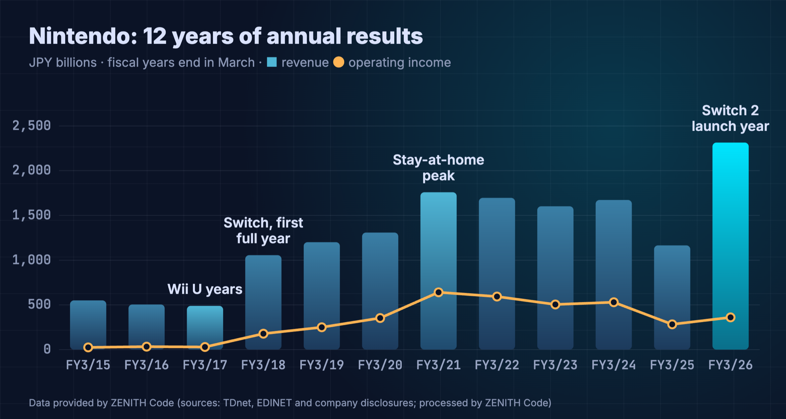

# 12 years of Nintendo's results in 25 lines of Python

Code for the dev.to article *I charted 12 years of Nintendo's results in 25 lines of Python*.



## Run

Requires Python 3.9+ and matplotlib (`pip install matplotlib`) and a [ZENITH Code API key](https://zenithcode.net/en/sign-up) (Free plan available).

```sh
export ZENITH_API_KEY=...        # keep it out of your shell history and repositories
python3 articles/devto/01-nintendo/nintendo.py         # Nintendo (7974)
python3 articles/devto/01-nintendo/nintendo.py 6758    # Sony Group
```

The script makes one request (`/stable/income-statement?period=annual&limit=12`) and saves `<code>.png` in the current directory.

- Securities codes are strings (`7974`, `130A`).
- `fiscalPeriod` is the fiscal year-end month: `2026-03` is April 2025 to March 2026.
- Missing values are drawn as gaps, never zeros.
- An unknown code returns an empty list; the script stops with a message.
- When the accounting standard changes within the range (Sony: US GAAP to IFRS), the script prints a note.

The chart image shows annual figures retrieved on 2026-11-18. Code is MIT-licensed; that does not grant rights to API data. Keep live responses for your own use under the [terms](https://zenithcode.net/en/terms).

Data provided by ZENITH Code (sources: TDnet, EDINET and company disclosures; processed by ZENITH Code). ZENITH Code does not warrant the accuracy, completeness or timeliness of the data, and nothing here is investment advice.
