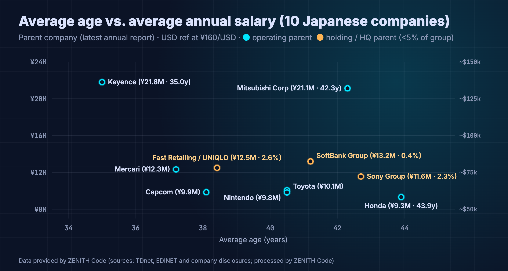

# Average salary, age, and tenure for 10 Japanese companies in Python

Code for the dev.to article *Honda's average tenure is 21 years. Mercari's is 4.5. I pulled salary & age data for 10 Japanese companies in Python*.



## Run

Requires Python 3.9+ and matplotlib (`pip install matplotlib`) and a [ZENITH Code API key](https://zenithcode.net/en/sign-up) (Free plan available).

```sh
export ZENITH_API_KEY=...        # keep it out of your shell history and repositories
python3 articles/devto/02-workforce/workforce.py
```

The script calls `/stable/workforce?symbol=<code>&limit=1` (1 token per company; 10 tokens total) and saves `salary_vs_age.png` in the current directory.

- Salary, age, and tenure in Japanese annual reports cover the **parent (filing) entity only** (`employees`), not the entire consolidated group (`consolidatedEmployees`).
- Unknown codes or entities without workforce tables return `HTTP 404`; the script skips them instead of plotting zeros.
- `fiscalPeriod` varies by company (e.g., `2026-03` for March fiscal year-end, `2025-08` for August, `2026-06` for June).

The chart images show figures retrieved on 2026-11-19 (reference USD values at ¥160/USD). Code is MIT-licensed; that does not grant rights to API data. Keep live responses for your own use under the [terms](https://zenithcode.net/en/terms).

Data provided by ZENITH Code (sources: TDnet, EDINET and company disclosures; processed by ZENITH Code). ZENITH Code does not warrant the accuracy, completeness or timeliness of the data, and nothing here is investment advice.
