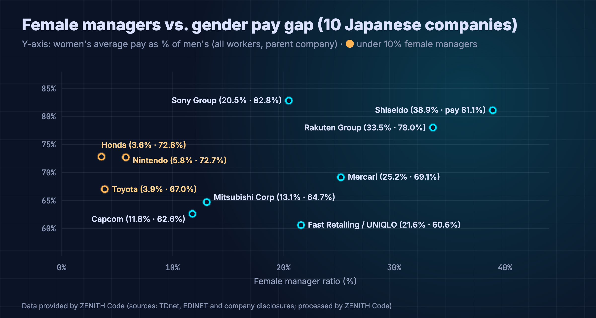

# Japan's gender pay gap, female manager ratio, and paternity leave in Python

Code for the dev.to article *Japan makes every public company disclose its gender pay gap — and why Honda's paternity leave is 116.8%*.



## Run

Requires Python 3.9+ and matplotlib (`pip install matplotlib`) and a [ZENITH Code API key](https://zenithcode.net/en/sign-up) (Free plan available).

```sh
export ZENITH_API_KEY=...        # keep it out of your shell history and repositories
python3 articles/devto/03-diversity/diversity.py
```

The script calls `/stable/diversity?symbol=<code>&limit=1` (1 token per company) and saves `diversity.png` in the current directory.

- `reportingCompany` covers the **parent (filing) entity only**. Subsidiary metrics are returned in `subsidiaries`.
- Individual fields can be `null` (for example, Keyence `6861` has `femaleManagerRatio: null`), and unknown codes return `HTTP 404`; the script skips them safely.
- Male paternity leave rates above 100% (e.g., Honda 116.8%, Mitsubishi Corp 171.7%) are valid under Japan's statutory formula (men taking leave in FY N ÷ men whose spouse gave birth in FY N).

The chart images show figures retrieved on 2026-11-19. Code is MIT-licensed; that does not grant rights to API data. Keep live responses for your own use under the [terms](https://zenithcode.net/en/terms).

Data provided by ZENITH Code (sources: TDnet, EDINET and company disclosures; processed by ZENITH Code). ZENITH Code does not warrant the accuracy, completeness or timeliness of the data, and nothing here is investment advice.
