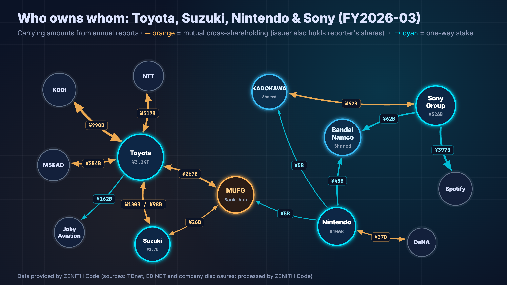

# Japanese cross-shareholdings as a network graph in Python

Code for the dev.to article *Japanese companies own each other — I mapped Toyota, Nintendo, and Sony's cross-shareholdings as a graph in Python*.



## Run

Requires Python 3.9+ and matplotlib (`pip install matplotlib`) and a [ZENITH Code API key](https://zenithcode.net/en/sign-up) (Free plan available).

```sh
export ZENITH_API_KEY=...        # keep it out of your shell history and repositories
python3 articles/devto/04-cross-shareholdings/cross_shareholdings.py
```

The script calls `/stable/cross-shareholdings?symbol=<code>&limit=1` (1 token per company), keeps the top 4 `specified` holdings of Toyota `7203`, Suzuki `7269`, Nintendo `7974`, and Sony Group `6758`, and saves `cross_shareholdings.png` in the current directory.

- `type` is `specified` (held directly for strategic reasons) or `deemed` (placed in a retirement-benefit trust with voting rights kept). The script uses `specified` only.
- `issuerHoldsOwnShares` is `"有"` (the other company holds shares back) or `"無"`. Mutual links are drawn in orange.
- Rows sold off during the year have `shares` and `carryingAmount` set to `null` and only carry last year's figures; the script skips them.
- Unknown codes and companies without the disclosure return `HTTP 404`; the script returns an empty list for them.
- Compare `shares` with `priorShares` carefully: stock splits change share counts (see `rationale`).

The chart images show figures retrieved on 2026-11-19 (checked again against the live API on 2026-11-20). Code is MIT-licensed; that does not grant rights to API data. Keep live responses for your own use under the [terms](https://zenithcode.net/en/terms).

Data provided by ZENITH Code (sources: TDnet, EDINET and company disclosures; processed by ZENITH Code). ZENITH Code does not warrant the accuracy, completeness or timeliness of the data, and nothing here is investment advice.
