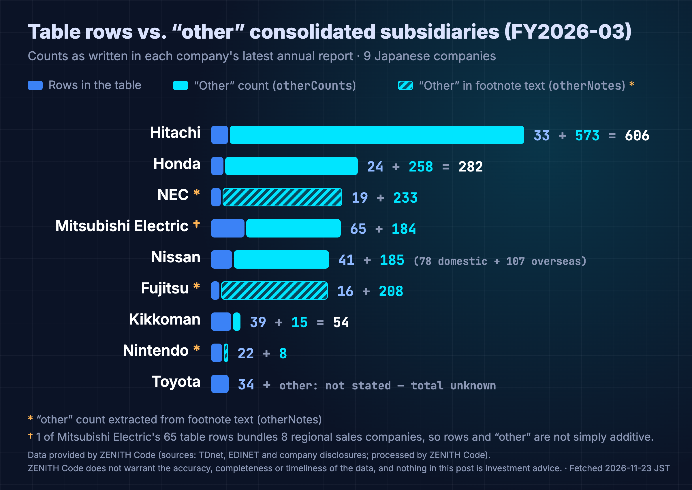

# Table rows vs. "other" subsidiaries in Japanese annual reports, in Python

Code for the dev.to article *Honda lists 24 subsidiaries in its annual report — then groups 258 more under "other"*.



## Run

Requires Python 3.9+ and matplotlib (`pip install matplotlib`) and a [ZENITH Code API key](https://zenithcode.net/en/sign-up) (Free plan available).

```sh
export ZENITH_API_KEY=...        # keep it out of your shell history and repositories
python3 articles/devto/05-subsidiaries/subsidiaries.py
python3 articles/devto/05-subsidiaries/subsidiaries.py --include-edge-cases   # also SoftBank Group (no "other" count) and a symbol that returns 404
```

The script calls `/stable/subsidiaries?symbol=<code>` (1 token per company; 9 tokens, or 11 with `--include-edge-cases`) for Hitachi, Honda, NEC, Mitsubishi Electric, Nissan, Fujitsu, Kikkoman, Toyota and Nintendo, waits 6.5 seconds between calls to stay under the free plan's 10 requests per minute, and saves `subsidiaries_table_vs_other.png` in the current directory.

- `counts` and `entities` cover only the rows listed in the table. Companies grouped under "other" are in `otherCounts` (sum every item whose `category` is `consolidated-subsidiary`; Nissan has two) or, when that is empty, in the footnote sentences in `otherNotes`.
- The script only takes a number from `otherNotes` when the count and the category (consolidated subsidiary vs. equity-method affiliate) are unambiguous; otherwise the row is labelled `needs review`.
- Empty `otherCounts` and `otherNotes` mean **unknown, not zero** (Toyota, SoftBank Group). A table row can also bundle several companies (one of Mitsubishi Electric's rows covers 8 regional sales companies), so rows plus "other" is not always a company count.
- Some valid securities codes return `HTTP 404`; the script reports "no subsidiaries data for this symbol" and carries on.
- `capitalCurrency` and `nameEn` can be `null` or absent. Guard them if you group by currency or print English names; `capitalText` keeps the capital as written in the filing.
- The offline tests in `tests/test_devto_articles.py` run the script against synthetic responses covering each of these cases.

No account yet? The [disclosure reader](../../../templates/disclosure-reader/README.md) runs on a saved snapshot with no API calls: `python3 templates/disclosure-reader/server.py`, then open view 8, *Group companies*, for the table rows, capital currencies and locations of five companies.

The chart images show figures retrieved on 2026-11-23 from each company's latest annual report (fiscal period `2026-03`). Code is MIT-licensed; that does not grant rights to API data. Keep live responses for your own use under the [terms](https://zenithcode.net/en/terms).

Data provided by ZENITH Code (sources: TDnet, EDINET and company disclosures; processed by ZENITH Code). ZENITH Code does not warrant the accuracy, completeness or timeliness of the data, and nothing here is investment advice.
