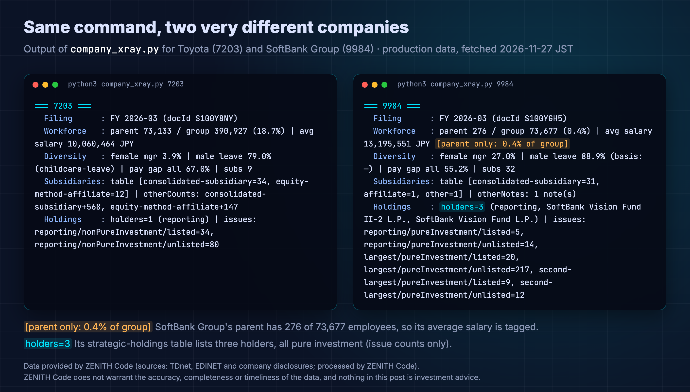

# Company X-ray: four Japanese annual-report disclosures in one command, in Python

Code for the dev.to article *One command, four disclosures: a "company X-ray" for any Japanese listed company in 60 lines of Python*.



## Run

Requires Python 3.9+ (standard library only) and a [ZENITH Code API key](https://zenithcode.net/en/sign-up) (Free plan available).

```sh
export ZENITH_API_KEY=...        # keep it out of your shell history and repositories
python3 articles/devto/07-company-xray/company_xray.py                       # Toyota (7203)
python3 articles/devto/07-company-xray/company_xray.py 7203 9984 2914 9399   # several codes
```

For each code the script calls `/stable/workforce`, `/stable/diversity`, `/stable/subsidiaries` and `/stable/cross-shareholdings` with `?symbol=<code>&limit=1` (1 token each, 4 tokens per company) and prints one block per company. It waits 6.5 seconds between companies to stay under the Free plan's 10 requests per minute.

- `cross-shareholdings` needs the Business plan or higher. On a Free key it returns `HTTP 403` (no token used) and the script prints `Business plan or higher required (HTTP 403)`; the other three lines are unchanged.
- Some valid codes return `HTTP 404` on all four endpoints (`9399`, `8951` when this was written). Each line prints `not_found` and the run continues. Other HTTP errors (such as 429) stop the run; nothing is retried.
- `null` is printed as `—`, never as `0`. `employees` and `averageAnnualSalary` describe the filing parent only; when the parent has less than 5% of the group's headcount the salary is tagged `[parent only: x% of group]`.
- `subsidiaries.counts` keys are read as they come (`affiliate` and `other` appear besides `consolidated-subsidiary` and `equity-method-affiliate`). Companies grouped under "other" are in `otherCounts` or, when that is empty, in the footnote sentences in `otherNotes`; the script prints the number of notes rather than guessing a count.
- For `cross-shareholdings` only holder names and issue counts per holder, purpose and listing are printed. Carrying amounts are not.
- The offline tests in `tests/test_devto_articles.py` run the script against synthetic responses covering each of these cases.

The images show figures retrieved from production on 2026-11-27 (fiscal period `2026-03`, JT `2025-12`). Code is MIT-licensed; that does not grant rights to API data. Keep live responses for your own use under the [terms](https://zenithcode.net/en/terms).

Data provided by ZENITH Code (sources: TDnet, EDINET and company disclosures; processed by ZENITH Code). ZENITH Code does not warrant the accuracy, completeness or timeliness of the data, and nothing here is investment advice.
