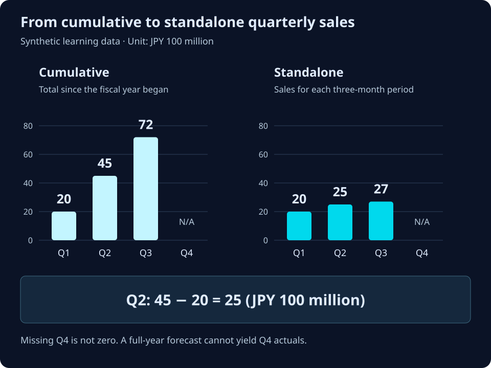

# TDnet lessons 3 and 4: offline examples

[README](../README.md) · [日本語の詳しい解説](learning.ja.md)

Start with TDnet, then move on to EDINET. These exercises use **authored, synthetic fixtures**, not actual filings or API responses. No account, API key, network access or extra packages are required. Run commands from the repository root with Python 3.9+.

If you have not cloned the repository yet, start here. Otherwise, use your existing checkout.

```sh
git clone https://github.com/Crab-grass/zenith-code-examples.git
cd zenith-code-examples
```

## Lesson 3: read a fact together with its context and unit

```sh
python3 python/learn_tdnet.py
```

The [reader](../python/learn_tdnet.py) reads one sales fact from a small [Inline XBRL teaching fixture](../learning/tdnet-sales.xhtml).

| Field | How to follow it | Result in this fixture |
| --- | --- | --- |
| `name` | Resolve the prefix to its namespace URI | TDnet `NetSales` |
| `contextRef` | Matching `xbrli:context` ID → `period` | 2025-04-01 through 2025-09-30 |
| Entity | Context → `entity/identifier` | Fictional `SYNTHETIC` |
| Dimensions | Context → `scenario/explicitMember` | Consolidated, actual |
| `unitRef` | Matching `xbrli:unit` ID → `measure` | JPY |
| `scale` | Attribute on the fact | Multiply by 10⁶ |
| `decimals` | Attribute on the fact | Precision, not another multiplier |

Displayed `4,500` × 10⁶ = **JPY 4,500,000,000**. Do not infer the period from the context ID, or the currency from the unit ID alone. Nil stays null. Missing/duplicate selected facts, unsupported formats and unsupported units fail explicitly.

The concept is matched by namespace URI and local name, not the literal prefix. This deliberately small reader rejects namespace rebinding and handles only the documented fixture format. It is **not a general XBRL processor**: no schema validation, taxonomy loading, statement hierarchy, filing corrections or accounting-standard mapping. The fixture uses TDnet concept names but is not a submission-ready instance. Consult [JPX's XBRL specifications](https://www.jpx.co.jp/equities/listing/disclosure/xbrl/03.html) for primary documentation.

## Lesson 4: turn cumulative sales into standalone quarters

```sh
python3 python/quarterly_chart.py --lang en
```

The [chart script](../python/quarterly_chart.py) reads [three synthetic cumulative actuals](../learning/quarterly-sales.json) and writes `output/quarterly-sales.en.svg`. Open that file in a browser or image viewer.



| Quarter | Cumulative | Standalone | Unit |
| --- | ---: | ---: | --- |
| Q1 | 20 | 20 | JPY 100 million |
| Q2 | 45 | 45 − 20 = 25 | JPY 100 million |
| Q3 | 72 | 72 − 45 = 27 | JPY 100 million |
| Q4 | Unavailable | Unavailable | JPY 100 million |

Both charts use the same vertical scale. The code requires the same company, concept, accounting basis, fiscal-year start, expected period ends, consolidated scope, actual status and currency. This is a fixed April-start teaching example.

- A full-year **forecast** of 110 does not make 110 − 72 a Q4 actual.
- Missing values are not zero. Missing inputs stop the calculation.
- Revisions require comparable inputs. If Q1 changes to 21 and remains comparable with Q2 cumulative 45, Q2 standalone becomes 24.
- Keep both source IDs for each subtraction. Fixture IDs such as `synthetic-q1` are not TDnet disclosure IDs.
- Do not reuse this subtraction for EPS, ratios or balance-sheet balances. Fiscal-year changes, accounting changes and correction reconciliation require separate handling.

## Read next

These service guides are currently in Japanese:

1. [TDnet XBRL analysis guide](https://zenithcode.net/learn/tdnet-xbrl)
2. [EDINET XBRL analysis guide](https://zenithcode.net/learn/edinet-xbrl), after the TDnet lessons
3. [Choosing a financial data API](https://zenithcode.net/learn/financial-data-api-selection)

For real company data, [create an account](https://zenithcode.net/en/sign-up) and use the [API examples](../README.md#start-here-real-data). Or follow the [agent-assisted setup guide](agent-start.md).
