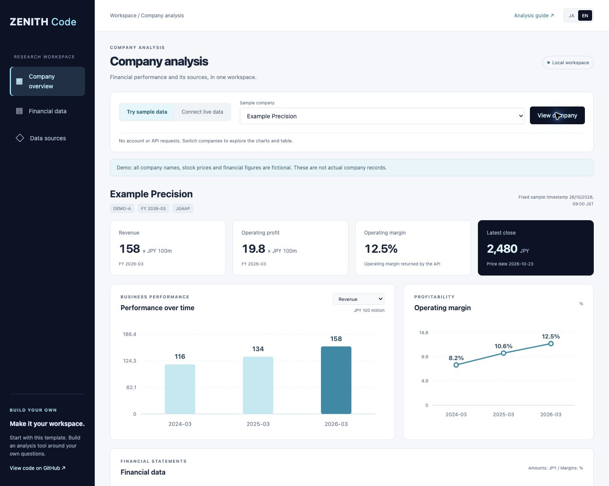

# Company analysis template

[日本語](README.ja.md) · [Repository README](../../README.md)

A runnable ZENITH Code workspace for exploring company performance, financial tables and data provenance. Use it as a starting point for your own private analysis tool.



## 1. Try it without an account

Requires **Python 3.9+ and a browser**. No packages, npm install or build step.

```sh
git clone https://github.com/Crab-grass/zenith-code-examples.git
cd zenith-code-examples
python3 templates/company-analysis/server.py
```

Open **http://127.0.0.1:8765** in your browser and select **EN**. Stop the server with **Ctrl+C**. If the port is busy, use `--port 8766`.

- Choose Example Precision or Example Cloud, then select **View company**.
- Switch between revenue, operating profit and net income in the chart menu.
- Toggle JA / EN for the interface, charts and notes.
- Inspect the financial table, reporting-period lengths, accounting basis and provenance.

**All demo company names, stock prices and financial figures are fictional.** No account or API calls are needed. Example Cloud includes losses and missing data.

## 2. Connect private live data

[Create an account](https://zenithcode.net/en/sign-up), accept applicable terms/data conditions, and create an API key in your dashboard. Stop the demo server, then run:

```sh
python3 templates/company-analysis/server.py --live
```

Enter the key in the terminal's hidden prompt, or provide it through `ZENITH_API_KEY` in your local environment. `.env` files are not loaded automatically. The key stays in the Python process; it is never sent to the browser. The template does not persist keys or responses in files or browser storage.

Select **Connect live data**, enter a securities code such as `7203` or `130A`, and press **Fetch data**. The existing `snapshot` example makes up to two requests:

| Endpoint | Display | Requests / API tokens |
| --- | --- | --- |
| `/stable/quote` | Latest close and its date | 1 / 1 |
| `/stable/income-statement?period=annual&limit=3` | Up to three annual income statements and provenance | 1 / 1 |

Checked against the public OpenAPI specification on 2026-10-26. Current plan, quota and data conditions apply. Startup, language changes and metric switches make no live requests. No automatic refreshes, retries or purchases. A failed fetch is not displayed as a partial result.

## Interpretation

- Full-year (`FY`) financials only; no cumulative-quarter subtraction in this interface.
- Amount cards and charts use **JPY 100 million**. The table shows full JPY values.
- Operating margin comes from the API: 0.125 displays as 12.5%.
- Missing values stay “—”; no fabricated zero bars or lines across missing periods. Actual zero remains zero.
- Period length and accounting basis are shown, but fiscal-calendar, consolidation and accounting changes are not adjusted. No custom growth rates, PER or PBR are calculated.
- Keep the price date, fiscal period, retrieval timestamp and record update timestamp distinct. Retrieval is not publication.
- Full `provenance`, including field sources and amendments, is inspectable. Filing URLs are not automatically visited.
- Live mode labels the company by securities code; it makes no additional company-name lookup request.

## Customize

| File | Purpose |
| --- | --- |
| `server.py` | Loopback-only local server using the existing API example |
| `index.html` / `style.css` | Layout, responsive styles and design tokens |
| `app.mjs` | Tables, SVG charts and JA/EN interface copy |
| `model.mjs` | Period ordering, response validation and formatting |
| `demo.json` | Publishable synthetic fixtures |

The browser cannot request arbitrary upstream URLs. The local server validates Host, Origin and a per-run request token, and prevents concurrent live fetches. This is a **single-user local template**, not an internet-facing or multi-user application. It has no user-login or organizational permission system.

Code is MIT-licensed; that does not grant rights to API data. Follow [display rights](https://zenithcode.net/en/docs/display-rights) and [terms](https://zenithcode.net/en/terms). Do not publish screenshots or outputs containing restricted live data.

Continue with the [TDnet lessons](../../docs/learning.md) or [agent-assisted setup](../../docs/agent-start.md).

## Explore styles and API mappings

Choose **Cool**, **Pop**, or **Dark** at the top. Themes change colors, card shapes, figure sizes, chart layout and spacing while keeping the same data. Switching themes sends no API requests. Your choice survives language/company changes within the page; reloading resets it to Cool.

Open **Which APIs build this page?** for example requests and the data-to-display flow. Each card, chart, table and provenance section has **API behind this view**, explaining its endpoint, response fields, units and missing-data handling. The performance chart explanation follows the selected metric. Opening an explanation sends no request.

Customize `body[data-theme]` and CSS variables in `style.css`; edit translations and `renderApiHelp()` in `app.mjs` for explanations. Data fetching is shared across themes.

Data mode and company selection sit directly below the page title. The API overview uses two endpoint cards and a data-to-display flow. Select controls retain native keyboard and mobile behavior, with a shared chevron inset 16px from the right edge.
