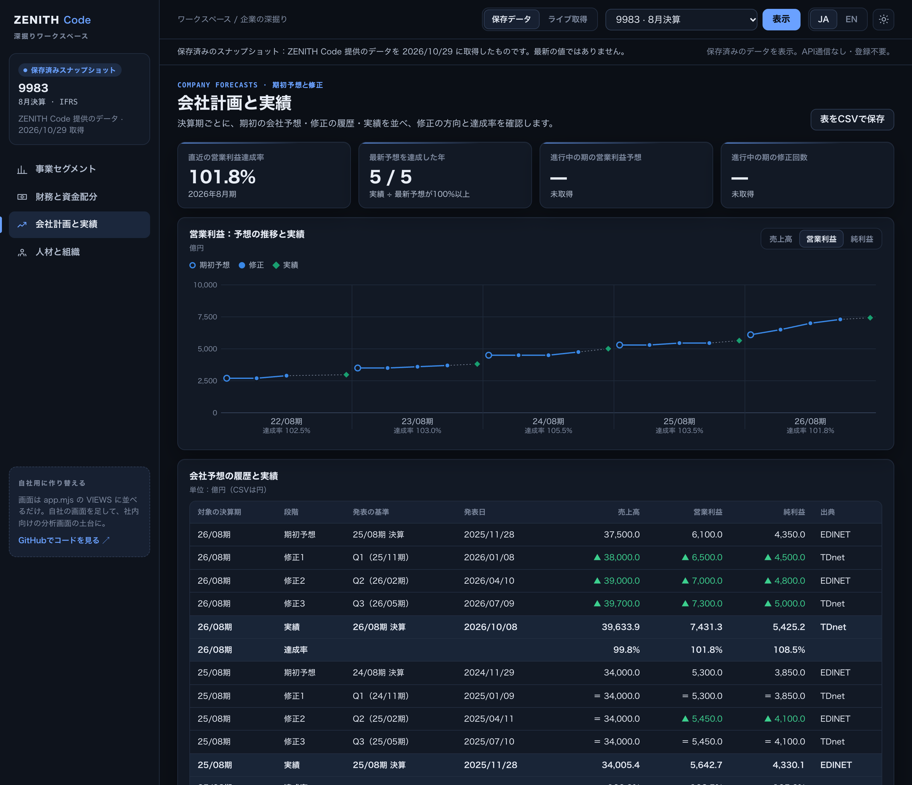

# 企業の深掘りワークスペース

[English](README.md) · [リポジトリのREADME](../../README.ja.md)

**1社**を4つの切り口で掘り下げる、ZENITH Codeのサンプル画面です。事業セグメント、財務の安全性と資金の使い道、会社計画と実績、人材と組織。経営企画・事業戦略の調査、重要顧客の営業計画、取引先の確認などを想定しています。社内向けの分析画面の土台として、そのままコピーして作り替えられます。



## 1. 登録不要で試す

必要なものは**Python 3.9以上とブラウザ**だけです。追加パッケージやビルドはありません。

```sh
git clone https://github.com/Crab-grass/zenith-code-examples.git
cd zenith-code-examples
python3 templates/company-deep-dive/server.py
```

**http://127.0.0.1:8790** をブラウザで開きます。終了は端末で **Ctrl+C**。ポートが使用中なら `--port 8791` を付けてください。

「保存データ」では、トヨタ自動車（7203・3月決算）、ファーストリテイリング（9983・8月決算）、花王（4452・12月決算）を表示します。**ZENITH Codeの実データをある日に取得して保存したもの**で、最新の値ではありません。取得日は画面上部と左の欄に出ます。登録もAPI通信も不要です。

- 左のメニュー（スマートフォンでは上部の切り替え）で4つの画面を移動。
- JA / EN と、ダーク / ライトのテーマを切り替え。言語とテーマはこのブラウザにだけ保存します。
- グラフにカーソルを合わせると値を表示。同じ値はグラフの下の表にもあります。
- 「表をCSVで保存」で、開いている画面の表を保存（金額は円、比率は小数、未取得は空欄）。

## 2. 実データに接続する

[会員登録](https://zenithcode.net/sign-up)のあと、規約・データ利用条件に同意し、APIキーを作成します。いったんCtrl+Cで止めて、次で起動し直します。

```sh
python3 templates/company-deep-dive/server.py --live
```

キーは端末の非表示入力で入れるか、環境変数 `ZENITH_API_KEY` に設定します。`.env` は読み込みません。キーはPythonのプロセスだけが持ち、ブラウザには送りません。ファイルやブラウザの保存領域にも書きません。

「ライブ取得」を選び、証券コード（例：`7203` / `130A`）を入れて「取得」を押します。1回の取得で、次のリクエストを**1つずつ順番に**送ります。

| # | API | 使い道 | リクエスト / APIトークン |
| --- | --- | --- | --- |
| 1 | `/stable/income-statement?symbol=…&period=annual&limit=5` | 計画と実績の実績値、決算期の並び | 1 / 1 |
| 2 | `/stable/balance-sheet-statement?symbol=…&period=annual&limit=5` | 自己資本比率・有利子負債・現金 | 1 / 1 |
| 3 | `/stable/cash-flow-statement?symbol=…&period=annual&limit=5` | 営業CF・投資CF・設備投資・配当・自社株買い | 1 / 1 |
| 4 | `/stable/segments?symbol=…` | 最新のセグメント情報 | 1 / 1 |
| 5 | `/stable/segments?symbol=…&fiscalPeriod=<前期>` | 前期のセグメント情報（4が空なら送らない） | 1 / 1 |
| 6 | `/stable/earnings-forecast?symbol=…&limit=20` | 会社予想の期初値と修正（おおむね5年分） | 1 / 1 |
| 7 | `/stable/workforce?symbol=…` | 従業員数・平均年齢・勤続年数・年間給与・セグメント別人数 | 1 / 1 |
| 8 | `/stable/diversity?symbol=…` | 女性管理職比率・男性育休取得率・男女の賃金差異 | 1 / 1 |

**1回の取得で8リクエスト・8 APIトークン**（セグメント情報がない会社は7）。5の「前期」は、最新のセグメント情報より前の損益計算書の決算期を使うので、決算期を変更した会社にも対応します。起動・画面の切り替え・言語やテーマの変更では通信しません。自動更新・再試行・追加購入はしません。途中で1つでも失敗したら取得全体を止め、途中までの結果は表示しません。

### ブラウザに送らないもの

`server.py` の `fetch_bundle()` が、APIごとに決めた項目だけを残してから返します。株価と株価から計算した値（`perForecast`・`psrForecast`・`pegRatioForecast`・時価総額・PER・PBR・配当利回りなど）は捨てます。TDnetの書類へのリンクとIDも送りません。`archiveUrl` は常に除き、`docId` / `sourceUrl` はEDINETの書類のときだけ残します。出典欄のリンクもEDINETのページだけです。

### 保存データを取り直す

`demo.json` は `fetch_bundle()` の出力を並べたもので、ライブ取得でブラウザが受け取る形と同じです。自分で取り直すときは次のとおりです（1社につき8リクエスト）。

```sh
python3 templates/company-deep-dive/build_demo.py            # 7203・9983・4452
python3 templates/company-deep-dive/build_demo.py 6758 7974  # 好きな会社で
```

キーは `ZENITH_API_KEY` か非表示入力から読みます。コマンドの引数には書きません。全リクエストが成功したときだけファイルを置き換えます。画面やファイルを共有するときは[データの表示・利用条件](https://zenithcode.net/docs/display-rights)に従ってください。

## 画面ごとの読み方

**事業セグメント**　セグメントの区分は会社が決め、組み替えや名称変更があります。前期比は両年のセグメント名が完全に一致するときだけ計算し、違うときは両年を別々に表示します。売上高は報告された `net_sales_total`（多くは外部顧客への売上）で、利益率はセグメント利益をこの売上高で割った値です。調整額と合計の行はグラフに入れません。地域別の情報が同じ注記に含まれる会社もあります。名前は報告どおりに表示します。

**財務の安全性と資金の使い道**　キャッシュ・フロー計算書では支出がマイナスなので、設備投資・配当・自社株買いは下向きの棒になります。フリーCF＝営業CF＋投資CF、「その他の投資」＝投資CF−設備投資です。設備投資が未取得の年は投資CFを1本で示し、配当か自社株買いが未取得なら株主還元と還元後の残りは計算しません。純有利子負債がマイナスならネットキャッシュです。

**会社計画と実績**　`forecastTarget` は各行の決算期を基準にした当期・翌期です。四半期の行は期末までの月数（Q1は+9か月、Q2は+6、Q3は+3）を足し、翌期ならさらに12か月を足して対象の決算期を求めます。`forecastFiscalPeriod` がある行はその値を優先します。3月決算以外でも同じです。決算期ごとに最初の予想を期初予想、以降を修正として発表日順に並べ、直前の予想と比べて ▲上方 ▼下方 ＝据え置き を付けます。達成率は「実績 ÷ 期末までに出た最新の予想」で、予想が0以下（赤字予想）のときや、予想と実績で会計基準が違うときは計算しません。純利益の実績は親会社株主に帰属する当期純利益を優先します。

**人材と組織**　平均年齢・勤続年数・年間給与は提出会社（単体）の値で、連結の従業員数とは対象が違います。男女の賃金の差異は男性を100%とした女性の割合で、職種や役職の構成は調整していません。男性の育休取得率は算定の基準で大きく変わるため基準を併記します。100%を超えることもあります。

どの画面でも「—」は未取得・未開示で、0には置き換えません。金額は億円で表示し、CSVでは円のまま保存します。

## 作り替える

| ファイル | 役割 |
| --- | --- |
| `server.py` | ローカル専用のサーバー。`fetch_bundle()` が1社分を取得して項目を絞る |
| `build_demo.py` | `fetch_bundle()` の出力を `demo.json` に保存 |
| `app.mjs` | 画面の登録（`VIEWS`）、共通の枠、表・CSV・出典 |
| `charts.mjs` | SVGの小さなグラフ（横棒・積み上げ・ウォーターフォール・折れ線・メーター） |
| `model.mjs` | 検証、セグメント・資金・会社予想の計算、表示形式（Nodeのテストと共用） |
| `i18n.mjs` | 日本語と英語の画面の文言 |
| `style.css` | ダーク・ライトのデザイン変数、レイアウト、スマートフォン対応 |

**画面を足す**　`app.mjs` の各画面は `VIEWS` の1要素です。`build(data)` は検証済みのデータを受け取り、KPI・グラフ・表・出典・読み方を返します。描画・CSV保存・出典欄は共通の枠が受け持ちます。

```js
const myView = {
  id: "margins",
  build(d) {
    const rows = d.years.map((y) => ({ fiscalPeriod: y.fiscalPeriod, margin: y.is?.operatingMargin ?? null }));
    return {
      kpis: [{ label: "直近の営業利益率", value: pct(rows.at(-1)?.margin), note: fy(rows.at(-1)?.fiscalPeriod) }],
      panels: [{ title: "営業利益率", unit: "%", wide: true,
        draw: (host, width) => lineChart(host, { width, label: "営業利益率", format: pct,
          points: rows.map((r) => ({ label: shortFy(r.fiscalPeriod), value: r.margin, valueLabel: pct(r.margin) })) }) }],
      table: { title: "営業利益率", unit: "%", rows,
        columns: [{ key: "fiscalPeriod", label: "決算期" }, { key: "margin", label: "利益率", num: true, format: (r) => pct(r.margin) }],
        csv: { name: "margins", columns: ["fiscalPeriod", "margin"] } },
      sources: [], notes: [],
    };
  },
};
export const VIEWS = [segmentsView, cashView, planView, peopleView, myView];
```

`i18n.mjs` の両言語に `nav_margins`・`view_margins`・`viewShort_margins`・`lead_margins`・`eyebrow_margins` を足し、`ICONS` にアイコンを1つ足します。別のAPIが必要なら、`fetch_bundle()` にリクエストと残す項目を足し、上のリクエスト表も直してください。

ブラウザから任意のURLへは問い合わせできません。ローカルサーバーがHost・Origin・起動ごとのトークンを確かめ、取得は同時に1つまでです。**1人で使うローカル用のテンプレート**で、インターネットに公開する仕組みや複数人のログインはありません。

コードはMITライセンスですが、APIデータの権利は含みません。[データの表示・利用条件](https://zenithcode.net/docs/display-rights)と[利用規約](https://zenithcode.net/terms)に従ってください。
