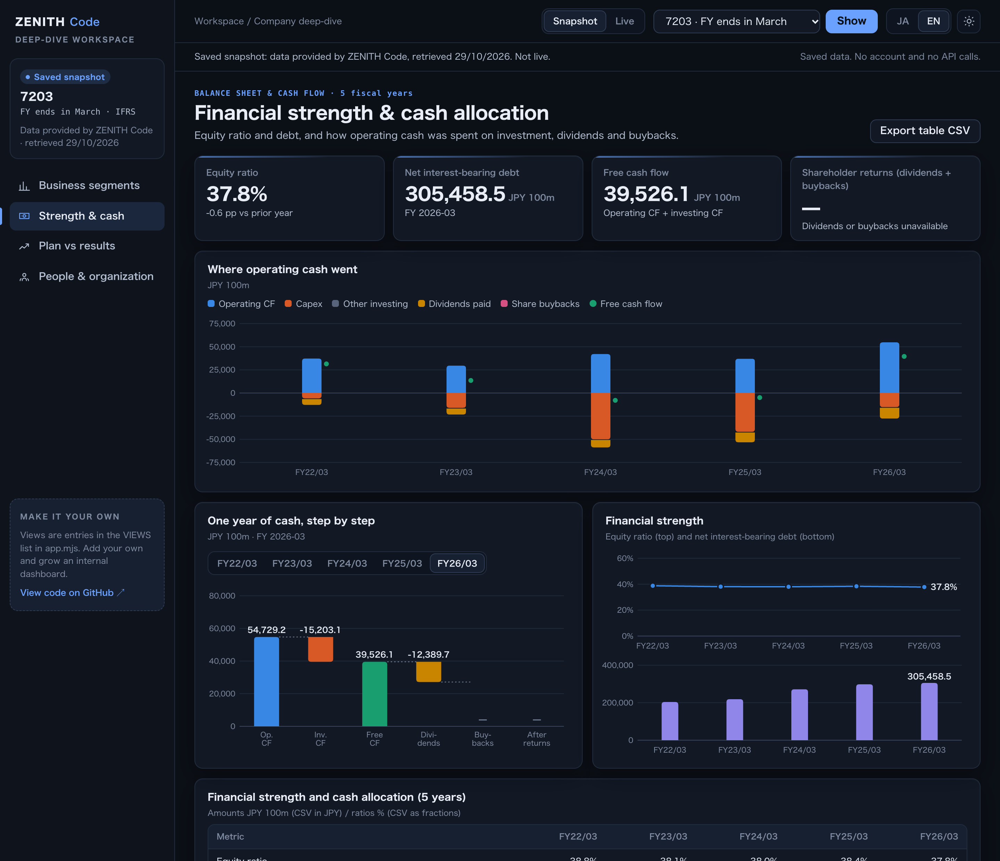

# Company deep-dive workspace

[日本語](README.ja.md) · [Repository README](../../README.md)

A runnable ZENITH Code workspace for digging into **one company** from four angles: business segments, financial strength and cash allocation, the company's own plan versus results, and people and organization. Built for strategy and corporate-planning teams, account planning for a key customer, or supplier reviews, and meant to be copied as the base of your own internal dashboard.



## 1. Try it without an account

Requires **Python 3.9+ and a browser**. No packages, npm install or build step.

```sh
git clone https://github.com/Crab-grass/zenith-code-examples.git
cd zenith-code-examples
python3 templates/company-deep-dive/server.py
```

Open **http://127.0.0.1:8790** and select **EN**. Stop the server with **Ctrl+C**. If the port is busy, add `--port 8791`.

The **Snapshot** mode shows data for Toyota Motor (7203, March year-end), Fast Retailing (9983, August year-end) and Kao (4452, December year-end). It is a **saved snapshot of real ZENITH Code data**, not live: the retrieval date is shown at the top and in the left panel. No account and no API calls are needed.

- Switch views from the left navigation (a segmented control on phones).
- Toggle JA / EN and the dark / light theme. Language and theme are remembered in this browser only.
- Hover a chart mark for its value; every value is also in the table below the charts.
- **Export table CSV** saves the active view's table (JPY amounts, ratios as fractions, missing values blank).

## 2. Connect live data

[Create an account](https://zenithcode.net/en/sign-up), accept the applicable terms and data conditions, and create an API key. Stop the snapshot server, then run:

```sh
python3 templates/company-deep-dive/server.py --live
```

Enter the key in the hidden terminal prompt, or set `ZENITH_API_KEY` in your environment. `.env` files are not read. The key stays in the Python process and is never sent to the browser; nothing is written to disk or browser storage.

Select **Live**, enter a securities code such as `7203` or `130A`, and press **Fetch**. One fetch sends these requests **one after another**:

| # | Endpoint | Used for | Requests / API tokens |
| --- | --- | --- | --- |
| 1 | `/stable/income-statement?symbol=…&period=annual&limit=5` | Actuals for plan vs results, fiscal calendar | 1 / 1 |
| 2 | `/stable/balance-sheet-statement?symbol=…&period=annual&limit=5` | Equity ratio, interest-bearing debt, cash | 1 / 1 |
| 3 | `/stable/cash-flow-statement?symbol=…&period=annual&limit=5` | Operating/investing CF, capex, dividends, buybacks | 1 / 1 |
| 4 | `/stable/segments?symbol=…` | Latest segment report | 1 / 1 |
| 5 | `/stable/segments?symbol=…&fiscalPeriod=<previous FY>` | Previous segment report (skipped when #4 is empty) | 1 / 1 |
| 6 | `/stable/earnings-forecast?symbol=…&limit=20` | Company forecasts: initial plan and revisions (about five years) | 1 / 1 |
| 7 | `/stable/workforce?symbol=…` | Headcount, age, tenure, salary, employees by segment | 1 / 1 |
| 8 | `/stable/diversity?symbol=…` | Female managers, male childcare leave, gender pay gap | 1 / 1 |

**8 requests / 8 API tokens per fetch** (7 when the company has no segment report). The previous fiscal year for #5 is the income-statement year before the latest segment report, so a change of fiscal year-end is followed. Startup, view, language and theme changes make no requests. No automatic refresh, retries or purchases. If any request fails, the whole fetch stops and nothing partial is shown.

### What never reaches the browser

`server.py` whitelists fields per endpoint in `fetch_bundle()` before replying. Stock prices and anything derived from them (`perForecast`, `psrForecast`, `pegRatioForecast`, market cap, PER, PBR, dividend yield…) are dropped, as are TDnet document links and IDs: `archiveUrl` is always removed, and `docId` / `sourceUrl` are kept only for EDINET documents. The provenance panel links only to EDINET pages.

### Refresh the snapshot

`demo.json` is a list of saved `fetch_bundle()` outputs — exactly what the browser receives in live mode. To save your own snapshot (8 requests per company):

```sh
python3 templates/company-deep-dive/build_demo.py            # 7203, 9983, 4452
python3 templates/company-deep-dive/build_demo.py 6758 7974  # your own selection
```

The key is read from `ZENITH_API_KEY` or a hidden prompt, never from the command line. The file is replaced only when every request succeeds. Follow the [display rights](https://zenithcode.net/en/docs/display-rights) before sharing screenshots or files.

## How to read each view

**Business segments.** Companies define their own segments and may reorganize or rename them. Year-over-year changes are computed only when both years report exactly the same segment names; otherwise both years are shown separately. Revenue is the reported `net_sales_total` (often sales to external customers), and margin is segment profit divided by that figure. Adjustment and total rows are kept out of the charts. Some companies include geographic information in the same note; names are shown as reported (in Japanese).

**Financial strength & cash allocation.** Outflows are negative in the cash flow statement, so capex, dividends and buybacks are drawn below zero. Free cash flow = operating CF + investing CF; “other investing” = investing CF − capex. When capex is unavailable, investing CF is shown as one bar; when dividends or buybacks are unavailable, shareholder returns and what is left after them are not computed. Net interest-bearing debt below zero means net cash.

**Company plan vs results.** `forecastTarget` is relative to each row's own period. A quarter row's target year is its quarter end plus the months to year-end (Q1 +9, Q2 +6, Q3 +3), and `next-fiscal-year` adds twelve months; an explicit `forecastFiscalPeriod` wins. This works for any year-end month. The first forecast for a year is the initial plan; later ones are revisions in announcement order, marked ▲ up, ▼ down or ＝ unchanged against the previous one. Achievement = actual ÷ latest forecast announced before the year ended; it is not computed for zero or loss forecasts, or when forecast and actual use different accounting standards. Net income actuals prefer profit attributable to owners of the parent.

**People & organization.** Average age, tenure and salary describe the reporting (parent) company, a different scope from consolidated headcount. The gender pay gap is women's pay as a share of men's and is not adjusted for job or grade mix. Male childcare leave depends on its basis, which is shown, and can exceed 100%.

Everywhere: “—” means unavailable or not disclosed and is never replaced with 0. Amounts are shown in JPY 100 million; CSV files keep full JPY.

## Customize

| File | Purpose |
| --- | --- |
| `server.py` | Loopback-only server; `fetch_bundle()` fetches and whitelists one company |
| `build_demo.py` | Saves `fetch_bundle()` outputs as `demo.json` |
| `app.mjs` | View registry, workspace shell, table/CSV and provenance |
| `charts.mjs` | Small inline-SVG charts (bars, stacked columns, waterfall, lines, meters) |
| `model.mjs` | Validation, segment/cash/forecast logic and formatting (shared with Node tests) |
| `i18n.mjs` | Japanese and English interface text |
| `style.css` | Design tokens for dark and light themes, layout and responsive rules |

**Add a view.** Each view in `app.mjs` is one object in `VIEWS`. `build(data)` receives the validated bundle and returns generic parts; the shell renders the KPI cards, chart panels, table, CSV export, notes and provenance:

```js
const myView = {
  id: "margins",
  build(d) {
    const rows = d.years.map((y) => ({ fiscalPeriod: y.fiscalPeriod, margin: y.is?.operatingMargin ?? null }));
    return {
      kpis: [{ label: "Latest operating margin", value: pct(rows.at(-1)?.margin), note: fy(rows.at(-1)?.fiscalPeriod) }],
      panels: [{ title: "Operating margin", unit: "%", wide: true,
        draw: (host, width) => lineChart(host, { width, label: "Operating margin", format: pct,
          points: rows.map((r) => ({ label: shortFy(r.fiscalPeriod), value: r.margin, valueLabel: pct(r.margin) })) }) }],
      table: { title: "Operating margin", unit: "%", rows,
        columns: [{ key: "fiscalPeriod", label: "Period" }, { key: "margin", label: "Margin", num: true, format: (r) => pct(r.margin) }],
        csv: { name: "margins", columns: ["fiscalPeriod", "margin"] } },
      sources: [], notes: [],
    };
  },
};
export const VIEWS = [segmentsView, cashView, planView, peopleView, myView];
```

Add `nav_margins`, `view_margins`, `viewShort_margins`, `lead_margins` and `eyebrow_margins` to both languages in `i18n.mjs`, and an icon path in `ICONS`. If the view needs another endpoint, add the request and its field whitelist to `fetch_bundle()` and update the request table above.

The browser cannot request arbitrary upstream URLs. The local server checks Host, Origin and a per-run request token, and allows one fetch at a time. This is a **single-user local template**, not an internet-facing or multi-user application.

Code is MIT-licensed; that does not grant rights to API data. Follow the [display rights](https://zenithcode.net/en/docs/display-rights) and [terms](https://zenithcode.net/en/terms).
