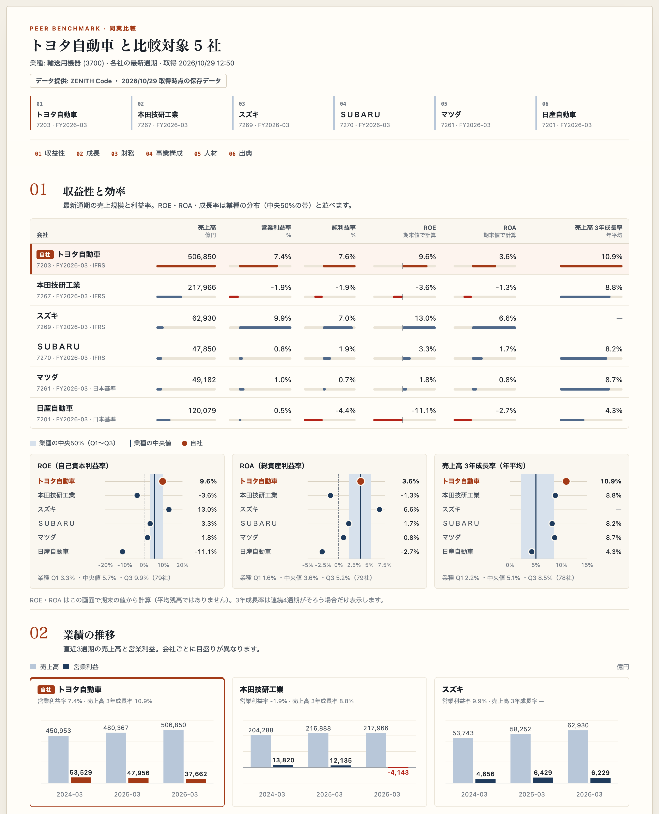

# 比較ボード（同業比較テンプレート）

[English](README.md) · [リポジトリのREADME](../../README.ja.md)

経営企画や事業開発の担当者向けに、**自社と競合最大5社**の収益性・成長・財務・事業構成・人材を1枚に並べる財務分析のサンプル画面です。A4横で印刷・PDF化して会議資料にしたり、比較表をCSVで保存したりできます。



## 1. 登録不要で試す

必要なものは**Python 3.9以上とブラウザ**です。追加パッケージやビルド作業はありません。

```sh
git clone https://github.com/Crab-grass/zenith-code-examples.git
cd zenith-code-examples
python3 templates/peer-benchmark/server.py
```

**http://127.0.0.1:8790** をブラウザで開きます。終了するときは端末で **Ctrl+C**。ポートが使用中なら `--port 8791` のように変更できます。

デモは、画面に表示された取得日に **ZENITH Code の実データを取得して保存したもの** です。最新の状態ではなく、その後の開示は反映されていません。デモではAPIを呼ばず、登録も不要です。

- 候補のチェックを外したり、保存済みのコードを追加したりして「比較データを取得」を押します。
- JA / EN、ライト / ダークを切り替えられます。印刷は常にライト表示です。
- 「印刷・PDF」でボタン類を除いたA4横の資料に、「CSVで保存」で比較表をファイルにできます。

## 2. 実際のデータに接続する

[会員登録](https://zenithcode.net/sign-up)後、適用される規約・データ利用条件に同意し、ダッシュボードでAPIキーを作成します。次のコマンドで起動し直します。

```sh
python3 templates/peer-benchmark/server.py --live
```

端末の非表示入力でキーを設定します。環境変数 `ZENITH_API_KEY` に設定済みならそちらを使います。`.env` は自動では読み込みません。**キーはブラウザへ送らず、ローカルのPythonプロセスだけが保持します。** データやキーをファイル・ブラウザの保存領域に記録しません。

「実データ」を選び、自社の証券コード（例: `7203`）を入れて「競合候補を表示」を押し、合計6社までチェック・追加してから「比較データを取得」を押します。

| 操作 | API | リクエスト数 |
| --- | --- | --- |
| 競合候補を表示 | `/stable/peers?symbol=…&limit=5` | 1 |
| 比較データを取得（1社ごと） | `/stable/income-statement?period=annual&limit=4` | 1 |
| | `/stable/balance-sheet-statement?period=annual&limit=1` | 1 |
| | `/stable/cash-flow-statement?period=annual&limit=1` | 1 |
| | `/stable/segments` | 1 |
| | `/stable/workforce` | 1 |
| | `/stable/diversity` | 1 |
| 比較データを取得（1回だけ） | `/stable/industry-benchmarks?sector=<自社の業種コード>` | 1（候補表示で業種コードが分かった場合だけ） |

**比較データの取得 = 6 × 社数 + 1**。6社なら37リクエストです。1社ずつ順番に取得し、並列には呼びません。途中で1件でも失敗したら比較全体を中止し、途中までの結果は表示しません。リトライ・自動更新はしません。言語・表示の切り替え、印刷、CSV保存ではAPIを呼びません。取得中にもう一度押しても、新しい取得は始まりません。プランの利用枠・データ利用条件が適用されます。

3年成長率をちょうど3年分の期間で計算するため、損益計算書は4通期分を取得します（推移のグラフは直近3通期）。

## ブラウザに渡すデータ

ローカルのサーバーが、画面に必要な項目だけを選んでブラウザに渡します。

- **株価や株価から計算する指標は渡しません。** `/peers` と `/industry-benchmarks` は株価・時価総額・PER・PBR・PSR・EV/EBITDA・配当利回り・騰落率も返しますが、サーバーで取り除きます。競合候補は種別・コード・社名・業種コードだけ、業種の分布は ROE・ROA・売上高成長率・EPS成長率の四分位だけを残します。
- **TDnet の書類リンクは渡しません。** `archiveUrl` は常に取り除き、`sourceUrl` は EDINET のものだけ残します。
- API側のエラー内容は画面に出しません。失敗は `upstream_failed` / `invalid_response` として扱います。

## 数字を誤読しないために

- 各社の**最新通期（FY）**を並べます。決算月が違う会社も同じ列に入るため、会社名の下の決算期を確認してください。
- 金額は**億円**で丸めて表示します。CSVは円単位、比率は小数のままです。
- **ROE・ROAはこの画面で期末の値から計算**します（ROE＝親会社株主に帰属する当期純利益÷親会社の所有者に帰属する持分〔なければ株主資本〕、ROA＝当期純利益÷総資産）。分母が0以下、値がない、貸借対照表の決算期が違う場合は「—」です。業種の分布とは算定方法が異なることがあります。
- **売上高の3年成長率（年平均）**は、連続する4通期がそろい、決算月と両端の会計基準が同じで、各期が通常の1年（360〜366日）の場合だけ計算します。
- **業種の帯**（Q1〜Q3と中央値）は自社の業種コードで取得します。競合が別の業種に属する場合もあります。
- **事業構成**は各社の開示どおりのセグメント（事業別・地域別など）で外部顧客への売上高の構成比を出します。合計・消去の行は除き、会社をまたいだ合算や名寄せはしません。色は各社内の並び順を示すだけです。
- **人材**の数値は連結従業員数を除き提出会社（単体）の値です。男性育休取得率は算定方法が会社で異なり、100%を超えることがあります。男女の賃金の差異は男性の賃金に対する女性の賃金の割合です。
- 未開示・未取得は「—」と表示し、0 としては扱いません。会計基準が違う会社の数値には定義の差が含まれます。

## デモデータを取り直す

`demo.json` は、実データ接続と同じ関数（`server.py` の `fetch_peers` と `fetch_bundle`）の出力をそのまま保存したものです。自分のキーで取り直すには次を実行します（初期値は自社 7203、競合 7267・7269・7270・7261・7201）。

```sh
python3 templates/peer-benchmark/build_demo.py
```

キーは `ZENITH_API_KEY` か非表示入力で渡し、コマンドラインには書きません。別の組み合わせは `--target` と `--peers 7267,7269` で指定します。1回の実行で最大43リクエスト（候補1＋社名の確認 最大5＋6×6＋1）で、すべて成功したときだけファイルを書き換えます。

## カスタマイズ

| ファイル | 役割 |
| --- | --- |
| `server.py` | ループバック専用サーバー、項目の絞り込み、`fetch_peers` / `fetch_bundle` |
| `build_demo.py` | 実データから `demo.json` を作る |
| `model.mjs` | 応答の検証、ROE・ROA・成長率、セグメント構成比、表示形式、CSV（Nodeのテストと共通） |
| `app.mjs` | 会社選び、表・分布帯・グラフ、日英の文言 |
| `index.html` / `style.css` | レイアウト、色の設定、ダーク表示、A4印刷 |
| `demo.json` | オフラインのデモ用に保存したデータ |

ブラウザから任意のURLへ取得させることはできません。サーバーは Host・Origin・起動ごとのトークンを確認し、実データの取得は同時に1つだけ受け付けます。**1人で使うローカル用のテンプレート**で、インターネットに公開する用途や複数ユーザーでの利用は想定していません。

コードはMITライセンスですが、APIデータの権利は含みません。印刷物やCSVを共有するときは[表示ルール](https://zenithcode.net/docs/display-rights)と[利用規約](https://zenithcode.net/terms)に従ってください。
