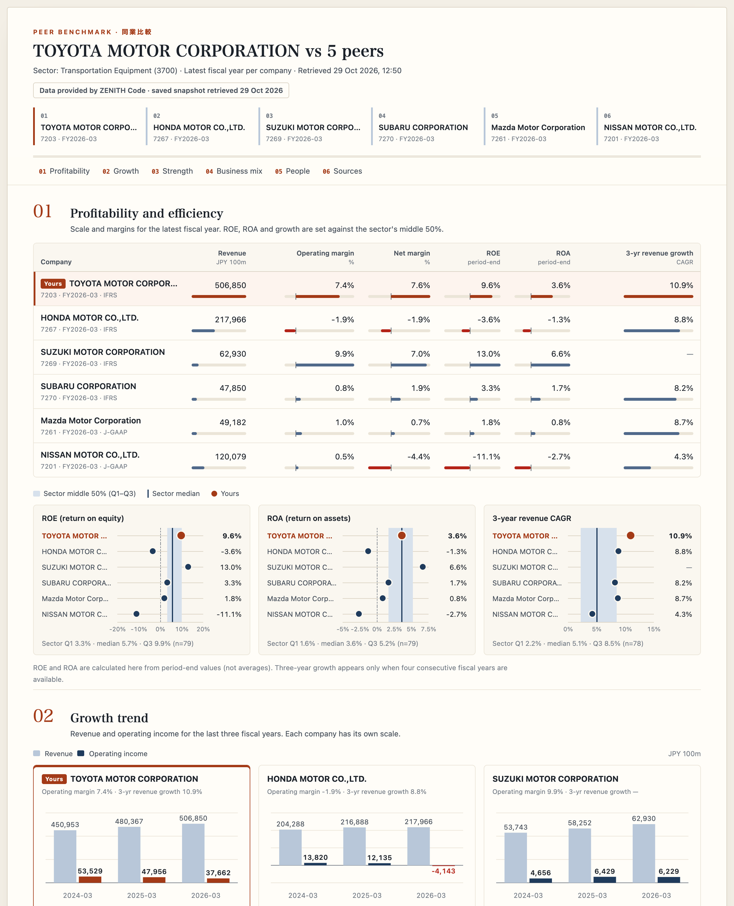

# Peer benchmark board

[日本語](README.ja.md) · [Repository README](../../README.md)

A runnable ZENITH Code template for corporate planning and business-development teams: line up **your company and up to five competitors** on profitability, growth, financial strength, business mix and people, then print it as an A4 landscape handout or export the table as CSV.



## 1. Try it without an account

Requires **Python 3.9+ and a browser**. No packages, npm install or build step.

```sh
git clone https://github.com/Crab-grass/zenith-code-examples.git
cd zenith-code-examples
python3 templates/peer-benchmark/server.py
```

Open **http://127.0.0.1:8790** and select **EN**. Stop the server with **Ctrl+C**. If the port is busy, use `--port 8791`.

The demo is a **saved snapshot of real ZENITH Code data**, taken on the retrieval date shown on the page. It is not live and may not reflect the latest filings. Demo mode makes no API calls and needs no account.

- Untick suggested companies, add codes from the snapshot, then press **Fetch comparison**.
- Toggle JA / EN and light / dark. Printing always uses the light layout.
- **Print / PDF** produces an A4 landscape handout without the controls; **Export CSV** saves the comparison table.

## 2. Connect private live data

[Create an account](https://zenithcode.net/en/sign-up), accept applicable terms/data conditions, and create an API key in your dashboard. Then run:

```sh
python3 templates/peer-benchmark/server.py --live
```

Enter the key in the terminal's hidden prompt, or provide it through `ZENITH_API_KEY` in your local environment. `.env` files are not loaded automatically. The key stays in the Python process and is never sent to the browser. Nothing is written to files or browser storage.

Select **Live data**, enter your securities code (for example `7203`), press **Suggest competitors**, tick or add up to six companies in total, and press **Fetch comparison**.

| Action | Endpoint | Requests |
| --- | --- | --- |
| Suggest competitors | `/stable/peers?symbol=…&limit=5` | 1 |
| Fetch comparison, per company | `/stable/income-statement?period=annual&limit=4` | 1 |
| | `/stable/balance-sheet-statement?period=annual&limit=1` | 1 |
| | `/stable/cash-flow-statement?period=annual&limit=1` | 1 |
| | `/stable/segments` | 1 |
| | `/stable/workforce` | 1 |
| | `/stable/diversity` | 1 |
| Fetch comparison, once | `/stable/industry-benchmarks?sector=<your sector code>` | 1 (only when the sector came from the suggestions) |

**Fetch comparison = 6 × companies + 1** — 37 requests for six companies. Companies are fetched one at a time, never in parallel. The first failed request aborts the whole comparison and nothing partial is shown. No retries, no automatic refresh; language, theme, print and CSV make no requests. A second click while a fetch is running is refused. Your plan's quota and data conditions apply.

Four annual income statements are requested so that the three-year growth rate spans three full years; the trend chart shows the latest three.

## What the server passes to the browser

The local server whitelists every field before it reaches the page:

- **No share prices or price-derived figures.** `/peers` and `/industry-benchmarks` also return price, market capitalisation, PER, PBR, PSR, EV/EBITDA, dividend yield and price changes; the server drops them. Peers keep only role, code, names and sector; benchmarks keep only ROE, ROA, revenue CAGR and EPS CAGR quartiles.
- **No TDnet document links.** `archiveUrl` is always dropped and `sourceUrl` survives only for EDINET.
- Upstream error bodies are never relayed: failures show as `upstream_failed` or `invalid_response`.

## Interpretation

- Each company shows its **latest fiscal year (FY)**. Companies with different year-ends share a column — check the fiscal period under each name.
- Amounts are rounded to **JPY 100 million**; the CSV keeps full JPY and ratios as fractions.
- **ROE and ROA are calculated here from period-end values** (ROE = profit attributable to owners ÷ equity attributable to owners, falling back to shareholders' equity; ROA = net income ÷ total assets). Zero or negative denominators, missing values or a balance sheet from another period give “—”. The sector distribution may use a different method.
- **Three-year revenue growth** (CAGR) needs four consecutive ordinary fiscal years (360–366 days) with the same year-end month and the same accounting standard at both ends.
- The **sector band** (Q1–Q3 with median) comes from your company's sector code. Peers can belong to another sector.
- **Business mix** shows external sales by segment as each company reports them (business lines or regions). Totals and eliminations are excluded; segments are never merged across companies. Colours only follow each company's order.
- **People** figures are for the reporting company (non-consolidated) except consolidated employees. Male childcare-leave methods differ by company and can exceed 100%. The gender wage gap is women's pay as a share of men's.
- Missing values show “—”, never zero. Figures under different accounting standards include definitional differences.

## Refresh the demo snapshot

`demo.json` is the saved output of the same functions the live server uses (`fetch_peers` and `fetch_bundle` in `server.py`). To regenerate it with your key (target 7203, peers 7267, 7269, 7270, 7261, 7201 by default):

```sh
python3 templates/peer-benchmark/build_demo.py
```

The key comes from `ZENITH_API_KEY` or a hidden prompt, never from the command line. Use `--target` and `--peers 7267,7269` for another set. One run makes up to 43 requests (1 suggestion + up to 5 name lookups + 6 × 6 + 1) and writes the file only if every request succeeds.

## Customize

| File | Purpose |
| --- | --- |
| `server.py` | Loopback-only server, field whitelists, `fetch_peers` / `fetch_bundle` |
| `build_demo.py` | Writes `demo.json` from live data |
| `model.mjs` | Validation, ROE/ROA/CAGR, segment shares, formatting, CSV (shared with the Node tests) |
| `app.mjs` | Selection flow, tables, bands, charts and JA/EN copy |
| `index.html` / `style.css` | Layout, colour tokens, dark mode and the A4 print sheet |
| `demo.json` | Saved snapshot for the offline demo |

The browser cannot request arbitrary upstream URLs. The server checks Host, Origin and a per-run request token, and allows one live fetch at a time. This is a **single-user local template**, not an internet-facing or multi-user application.

Code is MIT-licensed; that does not grant rights to API data. Follow [display rights](https://zenithcode.net/en/docs/display-rights) and [terms](https://zenithcode.net/en/terms) when sharing printouts or CSV files.
